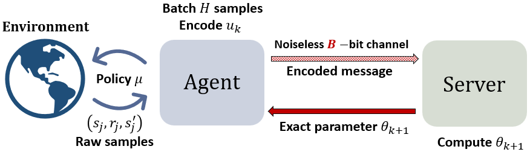

# Adaptive Quantization Preserves Fast Rates for TD Learning over Rate Limited-Channels

  

 
Motivated by reinforcement learning subject to communication constraints, we study a policy evaluation problem with linear function approximation over a rate-limited channel. In our setup, an agent interacting with an unknown environment (modeled as a Markov Decision Process) transmits quantized estimates of a temporal-difference (TD) learning update direction to a server over a finite-capacity channel. Our goal is to investigate to what extent one can preserve the statistical convergence rates achievable when the channel has infinite capacity. To that end, we propose a new algorithm called Batched Adaptively Quantized TD ( BAQ-TD), which uses batching to reduce the variance of the transmitted information, and adaptive quantization to encode innovations. We prove a high-probability finite-time error bound for BAQ-TD, and show that, above a certain finite channel capacity,  BAQ-TD preserves the convergence rate of unquantized TD up to logarithmic factors. Specifically, for a $d$-dimensional value function parameter, we establish that transmitting a total of $\mathcal{O}(d \log(T))$ bits over a horizon of length $T$ suffices to achieve the order-optimal rate of $\tilde{\mathcal{O}}(1/T)$, marking an exponential improvement in communication-complexity over prior work.
 

  
  
  

